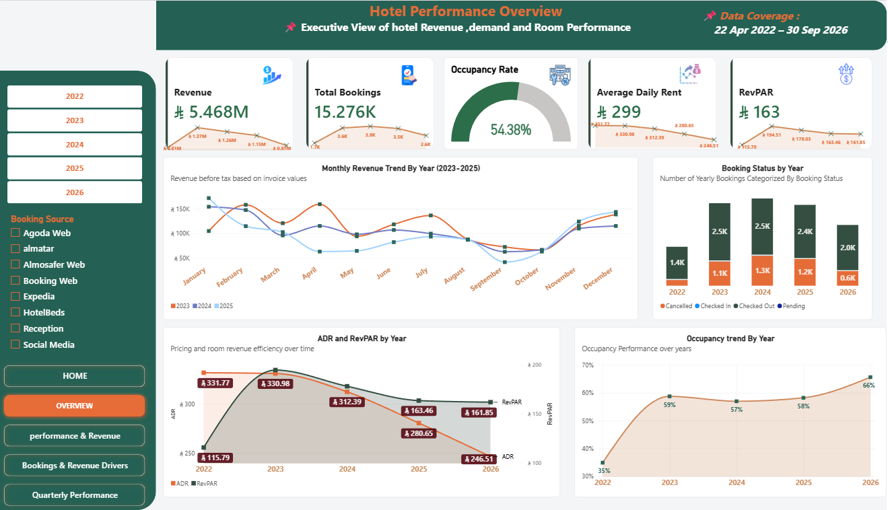
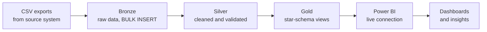
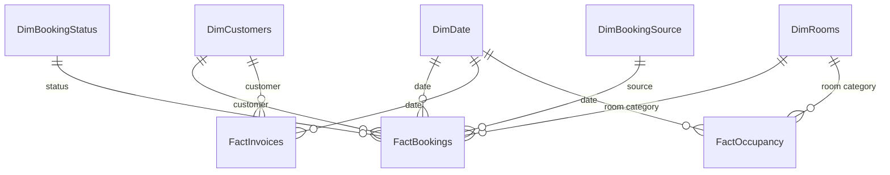
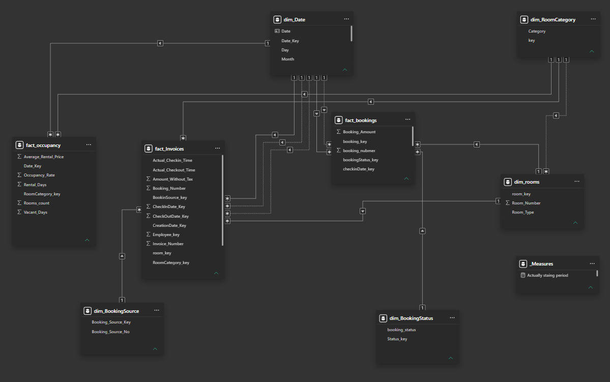
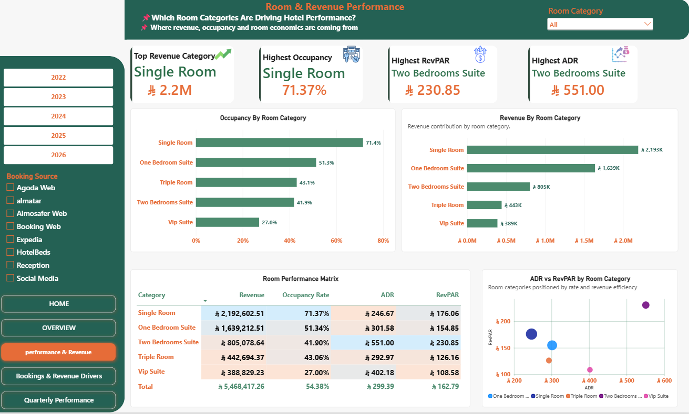

# Hotel Performance Analytics: From Raw CSV Exports to Management Insights

An end-to-end analytics project for a hotel: raw operational CSV exports are loaded into a **SQL Server data warehouse** (Bronze, Silver, Gold layers, Kimball-style dimensional model) and analysed in **Power BI** to explain revenue, room rates, occupancy and cancellations, then turned into concrete recommendations for management.

> **Headline result:** revenue fell **16.1%** between 2023 and 2025 (full years). The data points to **lower realized room rates** (ADR **−15.2%**) rather than fewer occupied nights (**−0.7%**), and the **cancellation rate peaked at 34.35% in 2024**.

> **Data privacy:** this was a freelance engagement. The hotel is anonymised and no guest or raw data is included in this repository.

---

## Table of contents
1. [Business problem](#1-business-problem)
2. [Architecture](#2-architecture)
3. [Project steps](#3-project-steps)
4. [Data quality and validation](#4-data-quality-and-validation)
5. [Data model](#5-data-model)
6. [Key measures](#6-key-measures)
7. [Insights](#7-insights)
8. [Recommendations](#8-recommendations)
9. [Dashboard pages](#9-dashboard-pages)
10. [Limitations](#10-limitations)
11. [Skills demonstrated](#13-skills-demonstrated)
12. [Contact](#14-contact)

---

## 1. Business problem
Hotel management had operational data spread across exports but no integrated view of revenue, bookings, occupancy, pricing and cancellations.

**Core question:** *How can management identify the main patterns behind changing revenue and make better-informed commercial decisions?*

The analysis answers seven questions:
1. How did revenue and completed bookings change over time?
2. Which room categories contribute the most revenue?
3. Which categories achieve the highest occupancy, ADR and RevPAR?
4. Is declining revenue linked to fewer bookings, lower realized rates, or both?
5. How has the cancellation rate changed?
6. Does revenue show recurring monthly patterns?
7. What actions can management investigate to improve performance?

## 2. Architecture

![Architecture]

| Layer | Purpose | What happens here |
|---|---|---|
| **Source** | Operational exports | CSV files extracted from the source system |
| **Bronze** | Preserve raw data | Files loaded with `BULK INSERT`, **no modification** |
| **Silver** | Make data reliable | Standardised formats, duplicate checks, NULL handling, all based on each table's **grain** |
| **Gold** | Make data reportable | Views with business-friendly column names, ready for reporting |
| **Power BI** | Analyse and communicate | Live connection to Gold, Power Query checks, date table, data model, DAX measures |

## 3. Project steps

1. **Extract:** exported the source data to CSV files.
2. **Bronze (raw):** built the warehouse following the **Kimball** approach inside a Bronze, Silver, Gold structure. Loaded each CSV with `BULK INSERT` exactly as received, so the original data is always recoverable.
3. **Silver (transformation):** unified data formats, checked for duplicates, and handled NULLs according to the **grain** defined for each table.
4. **Gold (presentation):** created **views** and renamed columns to final, report-ready names.
5. **Connect:** connected Power BI to the Gold views using a **live connection**.
6. **Model and measure (Power BI):** validated the data in **Power Query**, added a **Date table**, built the **data model**, and created the **DAX measures** listed below.
7. **Analyse:** built dashboard pages, extracted insights, and wrote recommendations.

## 4. Data quality and validation
- Investigated **duplicate booking records** and **duplicate invoice records**. Historical validation found **26 duplicate bookings** and **8 duplicate invoices**. Confirmed duplicates were removed while legitimate repeat records were preserved. These are historical cleaning findings, not a statement about the final dataset.
- Handled **booking numbers reused across different years** by validating a **composite business key** instead of relying on the booking number alone.
- Checked **customer matching across source tables**.
- Confirmed **relationships between facts and dimensions** before modelling.
- Defined the **grain** of each fact table so measures aggregate consistently.

## 5. Data model
Gold follows a star-schema (dimensional) design: fact tables hold measurable events and dimensions describe them.

*Simplified concept diagram: each analysis uses the relevant subset of tables.*

| Table type | Tables |
|---|---|
| **Facts** | `FactBookings`, `FactInvoices`, `FactOccupancy` |
| **Dimensions** | `DimDate`, `DimCustomers`, `DimRooms`, `DimBookingStatus`, `DimBookingSource` |

## 6. Key measures
Built in DAX on top of the Gold model:

| Measure | Definition |
|---|---|
| **Revenue** | Realized revenue (SAR) for the selected period |
| **Total Bookings** | All booking records, any status |
| **Completed Bookings** | Bookings with a completed status |
| **Cancellation Rate** | Cancelled bookings ÷ total bookings |
| **Occupied Room Nights** | Room nights actually occupied |
| **Occupancy Rate** | Occupied room nights ÷ available room nights |
| **ADR** (Average Daily Rate) | Room revenue ÷ occupied room nights |
| **RevPAR** | Room revenue ÷ available room nights |
| **Revenue per Completed Booking** | Revenue ÷ completed bookings (descriptive, **not** ADR) |
| **YoY % change** | Change versus the same period in the previous year |

## 7. Insights
Comparisons use **full years 2023 and 2025**. 2022 and 2026 are partial years and are not compared directly with full years.

### 7.1 Revenue fell 16.1% between 2023 and 2025
| | 2023 | 2025 | Change |
|---|---|---|---|
| Revenue (SAR) | 1,373,160 | 1,152,561 | **−16.1%** |
| Completed bookings | 2,537 | 2,361 | −6.9% |
| Revenue per completed booking (SAR) | 541.25 | 488.17 | −9.8% |

Fewer bookings (−6.9%) combined with lower revenue per booking (−9.8%) account for the −16.1% revenue change.

![Revenue]

### 7.2 Lower realized room rates, not fewer occupied nights
| | 2023 | 2025 | Change |
|---|---|---|---|
| ADR (SAR) | 330.98 | 280.65 | **−15.2%** |
| Occupied room nights | 4,125 | 4,095 | −0.7% |

At category level, ADR fell about **13.8%** for Single Room and **19.4%** for One Bedroom Suite. This is a descriptive pattern. Possible explanations (discounting, booking mix, room mix, length of stay) are hypotheses for further investigation.

![ADR vs nights]

### 7.3 Room categories have different profiles
| Category | Revenue (overall) | Occupancy | ADR (SAR) | RevPAR (SAR) |
|---|---|---|---|---|
| Single Room | ≈ 2.14M | 71.28% | – | – |
| Two Bedrooms Suite | – | 42.44% | 554.53 | 235.32 |
| VIP Suite | – | 26.98% | – | 109.91 |

Single Room brings volume; the suites earn more per room but fill less often. The highest-revenue category is not necessarily the one with the highest rate or RevPAR.

### 7.4 Cancellation rate peaked in 2024
| Year | Cancellation rate |
|---|---|
| 2023 | 29.34% |
| 2024 | **34.35%** |
| 2025 | 33.04% |

Up **+5.01 percentage points** in 2024, then down 1.31 pp in 2025, but still above 2023. A cancellation is not the same as lost revenue.

### 7.5 A recurring September dip
Monthly revenue shows a dip in September in 2023, 2024 and 2025, consistent with lower demand in that period (revenue alone does not prove the cause).

### 7.6 2026 so far: growth came from volume, not value
Comparing Q1 to Q3 of 2026 with the same quarters of 2025 (Q4 2026 excluded as incomplete):

| | Q1–Q3 2025 | Q1–Q3 2026 | Change |
|---|---|---|---|
| Revenue (SAR) | 821,776 | 870,600 | +5.9% |
| Completed bookings | 1,720 | 2,024 | +17.7% |
| Revenue per booking (SAR) | 478 | 430 | −10.0% |

## 8. Recommendations
These are areas to investigate. No financial benefit is claimed.

| # | Recommendation | Evidence | KPI to monitor |
|---|---|---|---|
| 1 | Investigate the decline in realized room rates | ADR −15.2% while occupied nights −0.7% | ADR by category and month |
| 2 | Review Single Room and One Bedroom Suite pricing | ADR down ≈13.8% and ≈19.4% | ADR, RevPAR, occupancy |
| 3 | Improve Two Bedrooms Suite occupancy | ADR 554.53, occupancy 42.44% | Occupancy, RevPAR |
| 4 | Review cancellation patterns and policies | 29.34% → 34.35% → 33.04% | Cancellation rate, timing |
| 5 | Plan for the recurring September slowdown | September dip in 2023–2025 | September revenue, occupancy, ADR |

## 9. Dashboard pages
The Power BI report has three pages:

1. **Hotel Performance Overview:** headline revenue, bookings and cancellation KPIs over time.
2. **Room & Revenue Performance:** revenue, occupancy, ADR and RevPAR by room category.
3. **Bookings & Revenue Drivers:** bookings, ADR and occupied room nights behind revenue changes.

<!-- Add your screenshots to docs/images/, then uncomment:

-->

A full presentation of the project is in [`docs/Hotel_Performance_Analytics`]().

## 10. Limitations
- 2022 and 2026 are partial years; conclusions compare full years only.
- Revenue and completed bookings must be compared using compatible date and record definitions.
- Revenue per completed booking is descriptive, not ADR.
- Trends and cancellation rates do not prove causation.
- Next analyses: realized rates, booking mix, length of stay, cancellation timing.

## 11. Skills demonstrated
- **Data engineering:** T-SQL, Bronze/Silver/Gold architecture, `BULK INSERT`, deduplication, NULL handling, views.
- **Data modelling:** Kimball dimensional modelling, star schema, fact-table grain, composite business keys.
- **BI:** Power BI live connection, Power Query, date table, DAX measures, dashboard design.
- **Analytics:** ADR, RevPAR, occupancy and cancellation analysis; seasonality; data storytelling and management recommendations.

## 12. Contact
**[Mahmoud Abdelsalam]** · [LinkedIn](https://www.linkedin.com/in/mahmoud-ahmed09/)

*Open to Data Analyst and BI Analyst opportunities.*
